# GuestBook Helper

一个完全离线的 GuestBook 库存可视化工具，使用 DeepSeek Harness 创作。导入 GuestBook 零售库存报表后，应用会按 **Store ID** 自动建立独立的 **.ngbd** 数据库，并提供仪表盘、搜索、排序、多维筛选和自定义标签。**1.8 新增 .ngbd 数据库导入与同名合并、最近三次快照回退、老出库记录视为销量，并修正空数据搜索提示。交付包仍然完全无预置数据。**

最低支持 **iOS 13**，同时适配 iPhone 与 iPad；使用 **SwiftUI + UIKit 原生控件**，数据库为 **SQLite**。在 **iOS 26 及以上** 自动使用原生 Liquid Glass 效果。

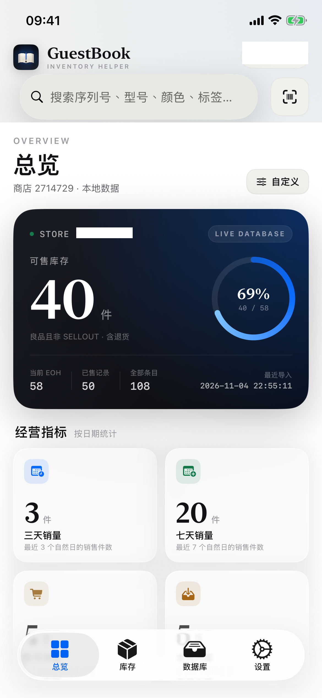

## 交付物

| 文件 | 说明 |
| --- | --- |
| [dist/GuestBookHelper-1.8-unsigned.ipa](dist/GuestBookHelper-1.8-unsigned.ipa) | arm64 未签名 IPA，6.0 MB，最低 iOS 13.0，**无任何预置数据** |
| [dist/GuestBookHelper-1.8-unsigned.ipa.sha256](dist/GuestBookHelper-1.8-unsigned.ipa.sha256) | SHA256：`0f226694049640f63ef2102c54b2e6b705ef67d03bb62f80b7221d73fc372c6f` |
| [GuestBookHelper.xcodeproj](GuestBookHelper.xcodeproj) | 可直接用 Xcode 打开的工程 |
| [Docs/verification.txt](Docs/verification.txt) | 160 项数据逻辑校验结果 |
| [dist/README.txt](dist/README.txt) | 未签名 IPA 安装说明 |

> 这是**未经代码签名**的 IPA，不能直接安装到普通 iOS 设备。请使用 Sideloadly、AltStore 等工具用自己的 Apple ID 重签后安装，或在 Xcode 中选择自己的 Team 运行。iOS 拒绝安装未签名应用属于正常现象。

## 功能

| 需求 | 实现 |
| --- | --- |
| EOH / LOG 识别 | 文件名含 **EOH**（不区分大小写）作为现有库存清单，含 **LOG** 作为销售记录；支持一次选择多个 xlsx 或分次导入 |
| 系统分享导入 | 在“文件”、邮件等 App 的分享菜单中选择 GuestBook Helper，可将 xlsx 直接发送到应用并开始导入；冷启动和运行中均支持 |
| 总览首页 | 底部最左侧新增“总览”并设为默认首页；原库存统计模块独立于此，库存页只保留条目列表与快捷筛选 |
| 总览自定义 | 可自由显示/隐藏库存总览、类别库存、三天销量、七天销量、本月销量、本月入库，选择持久保存 |
| 库存范围 | 库存页默认“在库 + 良品 + 排除展示机和无记录销售”；筛选面板中三项可独立开关 |
| 最新记录排序 | 已售条目按销售时间、出库条目按出库时间、退货条目按退货时间排序，不再按入库时间 |
| 记录日期 | 单一日期范围按条目完整生命周期匹配；只要所选日期内曾经在库即命中，不绑定入库或销售字段 |
| 快捷筛选 | 库存页顶部提供“在库良品 / 3天销售 / 7天销售”按钮；销售范围按自然日计算 |
| Code128 条码 | 条目详情复制按钮左侧新增“条码”；默认 30mm × 10mm，双指缩放至最大屏幕宽度，可切换是否在条码前加 S（不改变实际序列号） |
| 相机扫码 | 搜索框右侧扫码按钮调用高分辨率相机 + Vision；识别 Code128/Code39，只取 S 开头的序列号条码（避开 IMEI/UPC），自动去除 S 并填入搜索框。白底黑条码包装实物扫描已验证完全可用，黑底白条码包装待反馈 |
| 顶栏 | 移除 + 按钮与顶栏外框，顶栏和状态栏共用连续背景；新增扫码按钮 |
| 页面清理 | 设置数据框移除全部按钮；版本框仅保留应用名称和版本号；数据库页移除合并示例与底部文件位置说明框 |
| 无预置数据 | 发布包不包含 `.ngbd`、示例 `.xlsx`、Samples 目录或自动建库逻辑；首次启动总览/库存/数据库均为空状态，等待用户导入 |
| .ngbd 导入 | 数据库页“导入文件”同时支持 `.ngbd`；无同名数据库时直接导入，同名时让用户选择“合并数据”或“暂不导入” |
| 数据库快照 | 数据库详情展示最近 3 次更改的快照；导入报表、修改标签、合并数据库前自动创建，可一键回退，回退前会再备份当前状态 |
| 老出库视为销量 | 设置数据卡新增开关；打开后，最新状态为出库且出库日期 ≤ 2024-08-23 的记录计入销量，销售状态筛选也视为销售 |
| 空数据搜索 | 无数据库时搜索框提示“导入数据后开始搜索” |
| 出库状态 | 支持 **TRANSFER_OUT = 出库**；最新状态为出库的条目不计入库存、不可售，但可在库存状态筛选中筛选 |
| 精确时间 | 总览“最近导入”和库存条目日期为 `yyyy-MM-dd HH:mm:ss`，包含完整年月日时分秒 |
| 库存天数 | 条目详情显示库存天数：售出按销售时间、出库按出库时间、其余未售出按当前时间减去入库时间；向上取整，最少 1 天 |
| 无记录销售 | 系统标签“无记录销售”可手动添加；带该标签的条目仍可查看/搜索/筛选，但不计入总览、类别或数据库的实际库存 |
| 导入日期范围 | 导入完成提示展示本次 EOH/LOG 记录的 Date of Creation 范围、EOH/LOG 行数与 RETURNED 行数 |
| LOG 导出 | 将当前筛选后的条目导出为与导入 LOG 相同列格式的 `.xlsx`，可通过系统分享保存到“文件”或发送出去 |
| 按 Store ID 拆分 | 自动从 Store ID 中读取数字；每个 Store ID 生成一个 `<StoreID>.ngbd`，只写入该商店的条目。一个文件包含多个商店时会自动拆成多个数据库 |
| 库存字段 | 完整保存 Serial Number、Transaction Type、MPN、LOB、Sub LOB、Color、Capacity、Date of Creation、Store ID、Condition |
| 日期语义 | TRANSFER_IN 的创建日期写入**入库日期**，SELLOUT 写入**销售日期**，RETURNED 写入**退货日期**；同一序列号合并后保留各事件日期 |
| 退货状态 | 支持 **RETURNED = 退货**；退货条目的状态、退货日期都会保存，并可通过状态筛选和搜索“退货”。LOG 没有 Condition 时，RETURNED 按可售退货计入库存 |
| 库存口径 | 可售库存 = 未带“无记录销售”标签，且状态为 **RETURNED（Condition 为 GOOD 或未知）** 或 **最新 EOH 内 Condition=GOOD 的 TRANSFER_IN**；SELLOUT / TRANSFER_OUT / DEMO / DEFECTIVE 不计入 |
| 最新库存 | 再次导入 EOH 会刷新“最新 EOH”快照；不在最新 EOH 中的旧 TRANSFER_IN 条目保留为历史并退出库存；GOOD 的 RETURNED 退货仍按状态计入 |
| 条目浏览 | 总览展示统计，库存页展示条目列表；点击条目查看全部字段、条码和标签 |
| 排序 | 按条目**最新事件时间**从新到旧或从旧到新：售出/出库用对应时间，退货用退货时间；选择持久保存 |
| 筛选 | 记录日期范围、产品类别、产品型号、颜色、容量、库存状态（含退货）、商品状态、自定义标签；在库/良品/排除项可独立组合 |
| 数据库导入 | 数据库页按钮文字为“导入文件”，可选择 EOH/LOG xlsx 或 `.ngbd` 数据库 |
| 全局搜索 | 顶部固定搜索栏，检索序列号、MPN、类别、型号、颜色、容量、状态、条件、商店 ID、日期和自定义标签；多个关键词按 AND 匹配 |
| 类别库存 | 总览按产品类别显示在库数量；“无记录销售”标签条目会被排除，TRANSFER_IN 需在最新 EOH 内，RETURNED 不要求出现在最新 EOH 中 |
| 自定义标签 | 在条目详情中添加/移除标签，标签持久保存在对应 .ngbd 中；导入新报表或重新导入时不会丢失 |
| 搜索与标签 | 标签名称参与搜索；“筛选”中提供标签多选，并可与搜索同时使用 |
| 外观 | 自动跟随系统 / 浅色 / 深色，设置会持久保存；窗口级外观切换对所有原生控件生效 |
| Liquid Glass | iOS 26+ 使用原生 TabView、系统 Sheet/Menu 与玻璃按钮；顶栏改为与状态栏一致的连续背景；iOS 13–18 回退为实体卡片与系统控件 |
| 数据库访问 | 数据库保存在 `Documents/GuestBook/Stores`，可在“文件”App 中查看；数据库详情页支持分享 .ngbd 和删除数据库 |

## 数据规则

### 文件名与 Store ID

- 文件名包含 `EOH` → 现有库存清单。
- 文件名包含 `LOG` → 销售记录。
- Store ID 支持 `000000`、000000.0`、`Store 000000` 等写法，最终只保留数字并作为文件名：000000.ngbd`。
- 一个 xlsx 内出现多个不同 Store ID 时，分别为每个 Store ID 建立/更新数据库，条目不会串库。

### 字段对应

| xlsx 列 | 应用字段 | 说明 |
| --- | --- | --- |
| Serial Number | 序列号 | 同一商店内的主键 |
| Transaction Type | 库存状态 | TRANSFER_IN → 在库；SELLOUT → 已售；RETURNED → 退货；TRANSFER_OUT → 出库 |
| MPN | MPN | 产品详细型号 |
| LOB | 产品类别 | iPhone / iPad / Watch / AirPods 等 |
| Sub LOB | 产品型号 | 例如 iPhone 18 Pro |
| Color | 颜色 | |
| Capacity | 容量 | |
| Date of Creation | 入库/销售/退货日期 | 按 Transaction Type 写入；合并后各事件日期都保留 |
| Store ID | 商店 ID / 文件名 | 数字部分作为 .ngbd 文件名 |
| Condition | 商品状态 | GOOD → 良品；DEMO → 展示机；DEFECTIVE → 残次品 |

### 合并与库存口径

- 以 `Serial Number` 为每条库存的主键，将 EOH 与 LOG 的同一序列号合并为一条条目。
- 最新 EOH 中包含的条目标记为“当前 EOH”；不在最新 EOH 中的旧条目保留为历史记录。
- **可售库存 = 没有“无记录销售”标签，且状态为 RETURNED（Condition GOOD 或 UNKNOWN）或（TRANSFER_IN 且在最新 EOH 中且 Condition GOOD）**。TRANSFER_OUT、SELLOUT 均不计入。
- RETURNED 条目会写入独立的退货日期；即使最新 EOH 快照早于退货发生时间，退货仍会计入库存。明确标记为 DEMO / DEFECTIVE 的退货不计入。
- RETURNED 的 LOG 行通常没有 Condition；为避免“退货被当成未知而丢失”，LOG-only 的 RETURNED 会按可售退货处理。
- 带“无记录销售”标签的条目会被视为实际库存之外：可售总数、类别数量、数据库摘要均排除它，但它仍保留在列表、搜索和筛选中。
- 总览按 LOB 汇总上述库存；使用 `Fixtures/` 测试报表时结果为：iPhone 23、iPad 9、AirPods 5、Watch 3，共 **40** 件。
- `Fixtures/` 测试文件合并后共 108 条条目、50 条已售记录、18 台展示机；这些文件不在 App 包内。
- 旧版 .ngbd 会在打开时自动迁移，新增 `returned_date`、`transfer_out_date` 字段和系统标签，已有条目和标签不丢失。
- 提供的 `Inventory_LOG_Export_2026-11-03 2.xlsx` 中还有 1 行 `TRANSFER_OUT`；现已将其作为“出库”正常入库，不计入库存，并可在库存状态筛选中查看。
- “无记录销售”标签由数据库自动创建，不能删除；可在条目详情中一键标记，也可在标签编辑器中勾选。
- 时间显示：总览“最近导入”和库存条目日期均精确到秒；条目详情的入库/销售/退货/出库日期也使用同一精度。
- 库存天数：售出条目用销售时间、出库条目用出库时间、其余未售出条目用设备当前时间，减去入库时间；不足 1 天按 1 天，向上取整。

### 总览指标

- **三天销量**：当前状态为 SELLOUT、且销售日期在最近 3 个自然日内的条目数。
- **七天销量**：当前状态为 SELLOUT、且销售日期在最近 7 个自然日内的条目数。
- **本月销量**：当前状态为 SELLOUT、且销售日期在当前自然月内的条目数。
- **本月入库**：当前自然月内有入库日期的条目数。
- 总览右上角“自定义”可逐项显示/隐藏六个模块；设置写入 UserDefaults，下次启动保留。

### 条码

- 条目详情中“复制”左侧的“条码”进入 Code128 页面；默认开启 **生成带 S 的条码**。
- 默认按 30mm × 10mm 显示；双指可放大，最大至屏幕宽度，最小恢复默认尺寸。
- 页面底部显示实际序列号、型号、颜色、容量；S 仅参与条码生成，不改变实际序列号。
- 条码已用系统 Vision 在实际截图中识别为 Code128，内容为 `SD5612W1JQ1`。

### 相机扫码

- 搜索框右侧扫码按钮调用高分辨率相机；使用 `AVCaptureVideoDataOutput` 的 1920×1080 视频帧交给 Vision `VNDetectBarcodesRequest`，连续自动对焦。
- 支持 Code128 / Code39；仅取以 **S** 开头的序列号条码，避免扫描同盒的 IMEI2 / IMEI/MEID / UPC 条码。
- 识别后去掉 S 填入搜索框，并自动切到库存页、清除可能遮挡结果的筛选。
- 首次使用会请求相机权限；无相机或权限被拒绝时显示说明。

### 实物扫码验证（1.5）

- 使用 iPhone 16e 包装盒照片验证。
- 包装盒印刷内容为 `(S) Serial No. AAAAAAAAAA`；其下方一维码是 **Code128**，实际编码内容为 `SAAAAAAAAAA`。
- 应用只接受 S 开头的 Code128，并去掉 S，因此写入搜索框的结果是 AAAAAAAAAA。
- 同一张照片中还存在 IMEI2、IMEI/MEID 和 UPC 一维码；它们不以 S 开头，会被忽略。
- 使用 Vision 对该照片实测：`barcode=SAAAAAAAAAA serial=AAAAAAAAAA`，结果通过。

### LOG 导出

- 库存页“库存条目”右侧的分享图标可导出当前筛选结果。
- 导出内容会先应用搜索、状态、日期、类别、型号、颜色、容量、Condition 和标签筛选；例如先筛选“已售”即可只导出销售记录。
- 导出文件为真正的 `.xlsx`，列与导入 LOG 完全一致：`Serial Number, Transaction Type, MPN, LOB, Sub LOB, Color, Capacity, Date of Creation, Store ID`。
- 导出后通过 iOS 系统分享面板保存到“文件”或发送到其他 App；文件名包含 `LOG`，可再次导入。

### .ngbd 数据库导入与合并

- 数据库页“导入文件”接受 EOH/LOG xlsx，也接受 `.ngbd`。
- 若目标 Store ID 没有同名数据库，直接复制导入并打开。
- 若已有同名数据库，弹出选择：
  - **合并数据**：先自动创建快照，再把导入数据库的条目、事件日期和标签合并到现有库；同序列号保留并合并两边数据。
  - **暂不导入**：保留现有数据库不变。
- 合并前会生成快照，可回退。

### 数据库快照

- 每次导入报表、修改/重命名/删除标签、合并 `.ngbd` 前，自动对当前数据库拍快照。
- 每个数据库最多保留最近 **3** 次快照，超出的旧快照自动删除。
- 数据库详情页“快照”卡片显示时间与原因，点击“恢复”可回退。
- 恢复前会再自动备份当前状态；恢复后刷新数据库和统计。

### 老出库记录视为销量

- 设置 → 数据 → “老出库记录视为销量”开关，默认关闭。
- 打开后，最新状态为 `TRANSFER_OUT` 且出库日期为 **2024-08-23 23:59:59（本地时间）及之前** 的条目：
  - 计入总览/数据库“已售”数量；
  - 在筛选“已售”状态时视为销售；
  - 在销售日期范围筛选中使用出库日期作为销售日期。
- 关闭后恢复原始出库语义。
- 该开关只影响销量统计与销售筛选，不改变库存口径或原始 Transaction Type。

### 数据库

数据库为真实 SQLite 文件，扩展名为 **.ngbd**。主要表：

- `items`：库存条目与入库/销售/退货日期、Condition、最新 EOH 标记。
- `tags`：自定义标签。
- `item_tags`：条目标签关联。
- `import_history`：每次导入的文件名、类型、行数与时间。
- `meta`：最后一次 EOH/LOG 导入时间等元数据。
- `Snapshots/<StoreID>/`：数据库快照文件与 manifest（最近 3 次）。

把 .ngbd 临时改名为 .sqlite 即可用任意 SQLite 工具查看。

## 界面

> 应用包本身无数据。下图先展示首次启动的空状态；其余截图使用 `Fixtures/` 测试报表导入后拍摄，仅用于说明功能。

| 首次启动 · 总览 | 首次启动 · 数据库 |
| --- | --- |
| 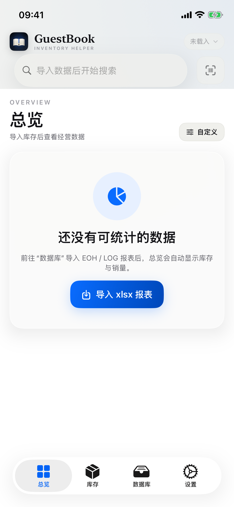 |  |

| 总览浅色（测试数据） | 总览深色（测试数据） |
| --- | --- |
|  | 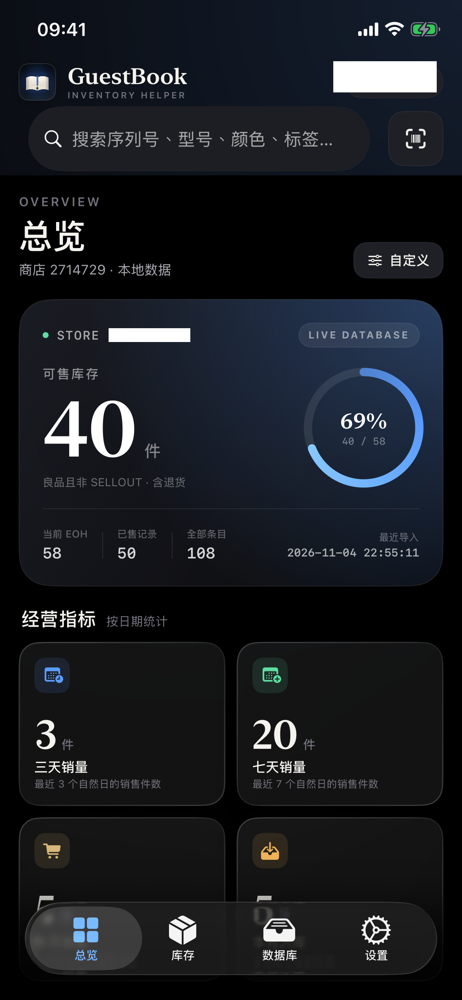 |

总览自定义：

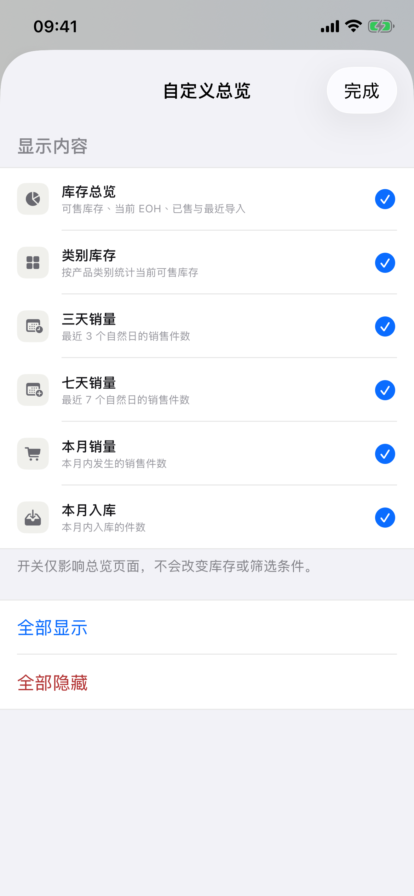

| 库存默认在库良品 | 3天销售快捷筛选 |
| --- | --- |
| 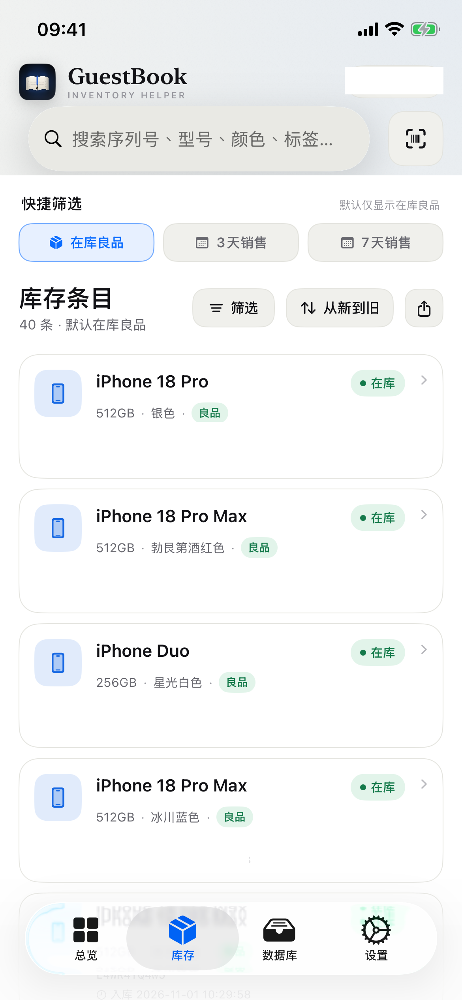 | 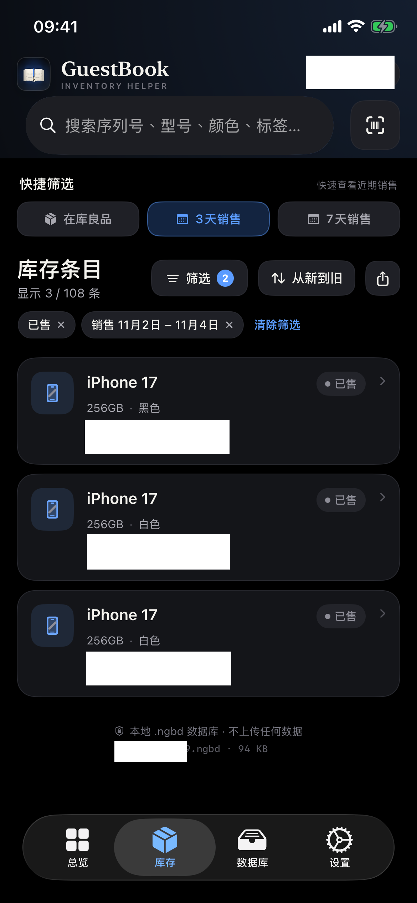 |

| 筛选（在库/良品分离、含退货） | 数据库（导入文件） |
| --- | --- |
| 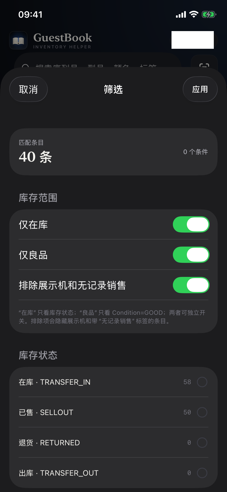 | 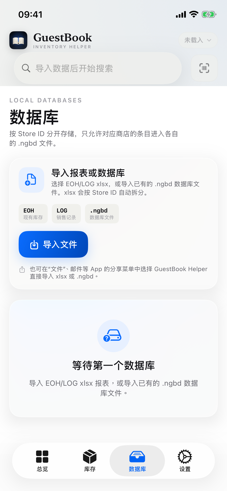 |

| 条目详情（条码按钮、库存天数） | Code128 条码 |
| --- | --- |
| 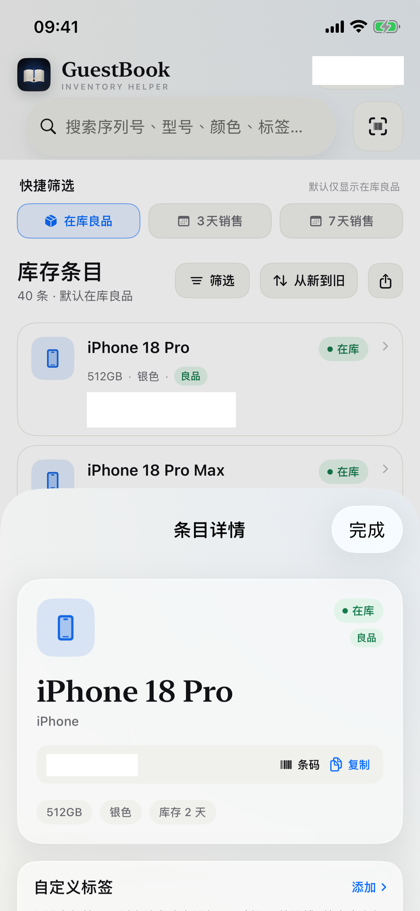 | 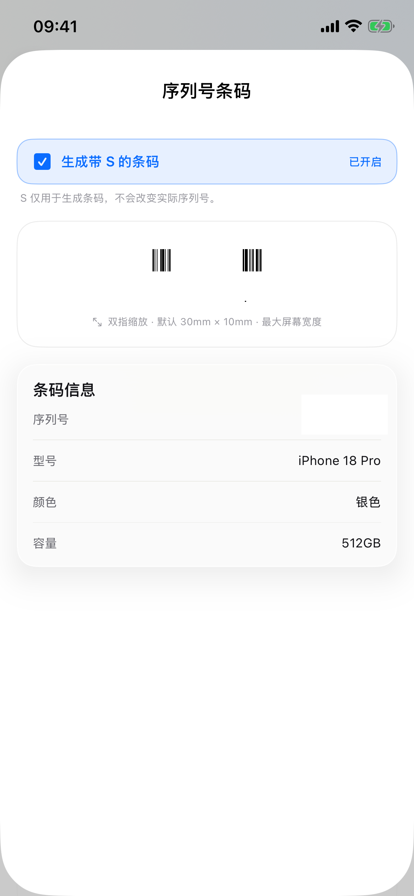 |

相机扫码（模拟器无相机时的提示）：

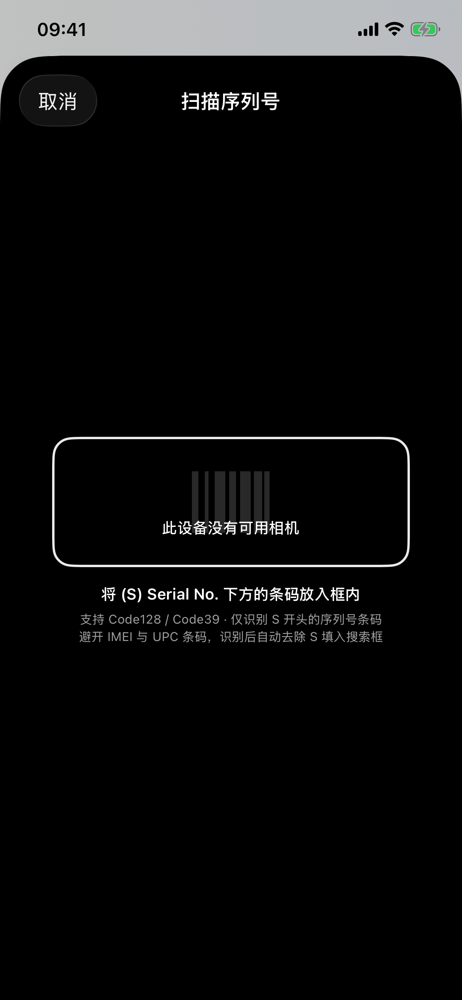

| 设置（含老出库开关） | 标签管理 |
| --- | --- |
| 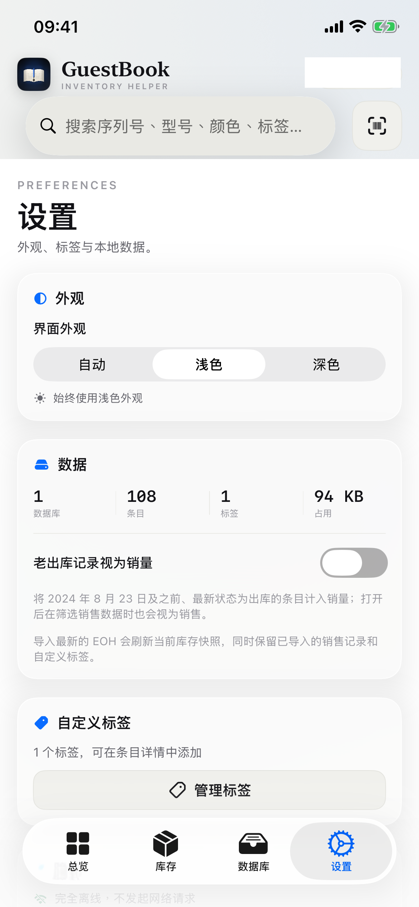 |  |

| 数据库快照 | 同名数据库导入选择 |
| --- | --- |
| 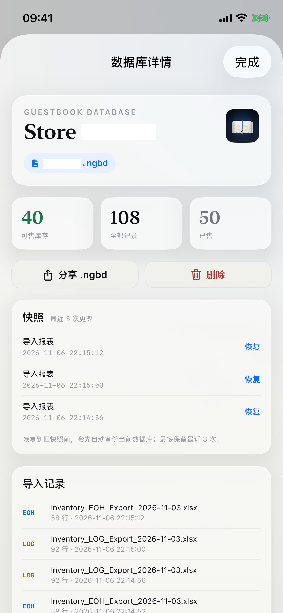 | 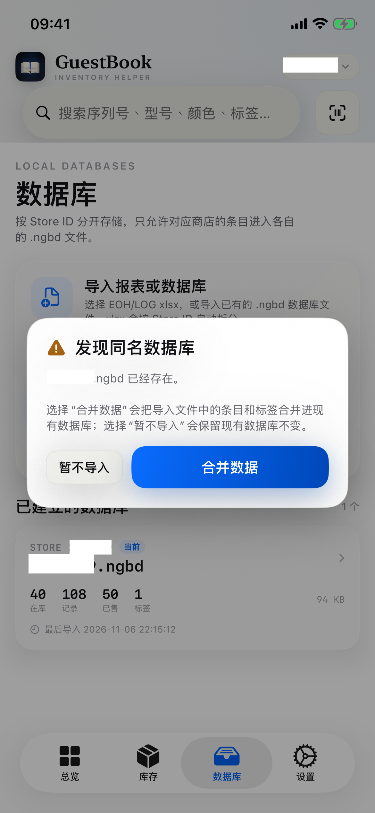 |

RETURNED 退货状态：

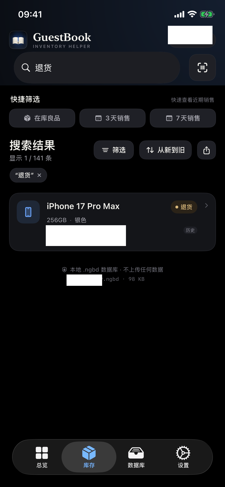

“无记录销售”标签：

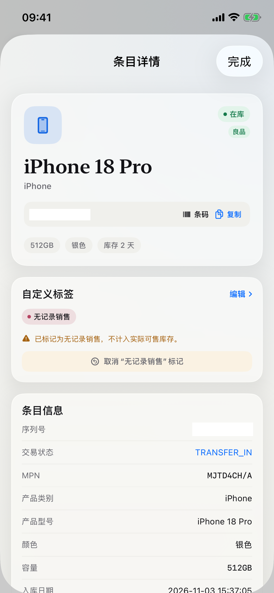

TRANSFER_OUT 出库状态：

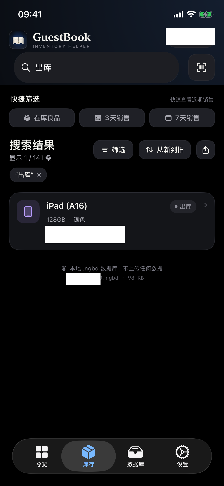

| 导入结果 |
| --- |
| 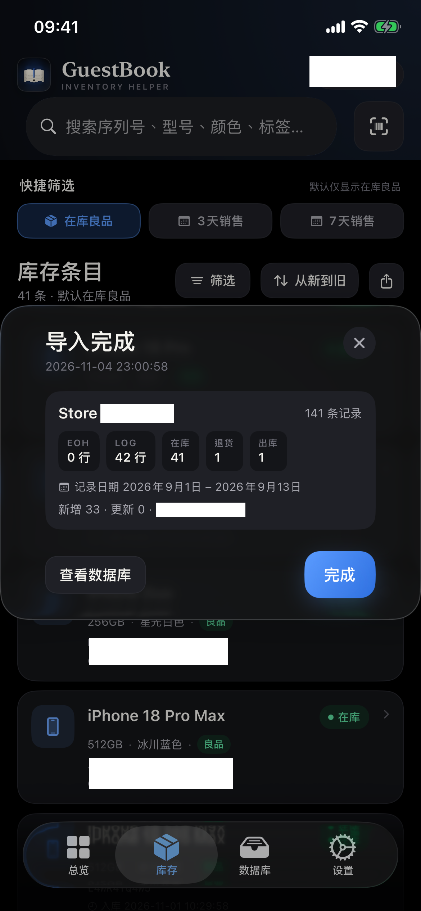 |

iPad（iOS 26 Liquid Glass）：

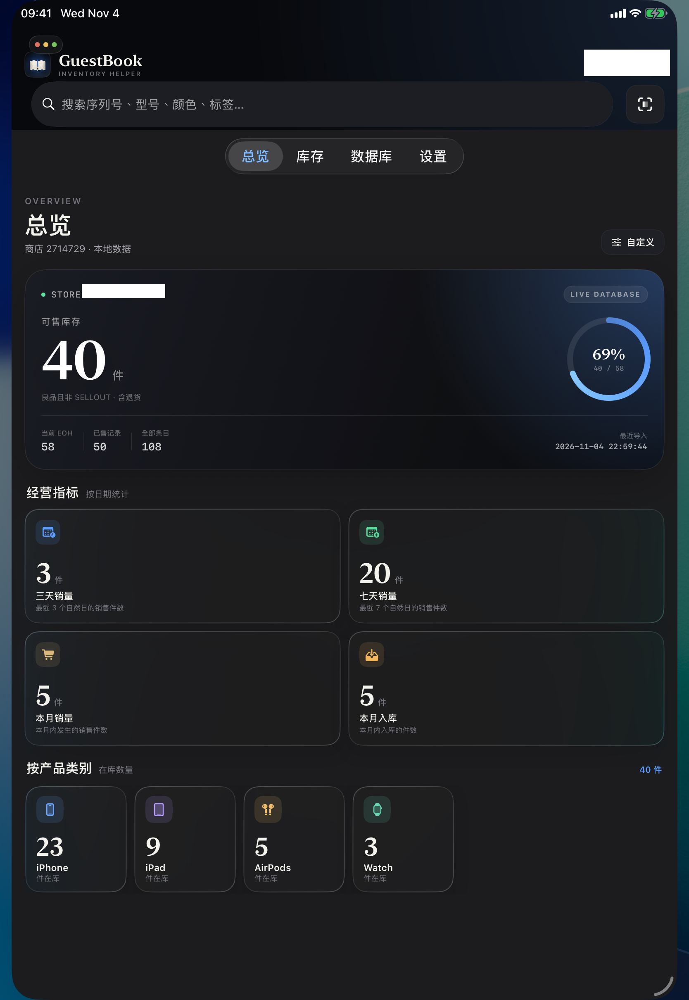

应用图标与启动画面：

| 图标 | 启动画面 |
| --- | --- |
|  |  |

## 快速开始

1. 安装并打开应用。首次启动**没有任何数据库或示例库存**，总览、库存、数据库都为空；不会自动创建 `.ngbd`。
2. 进入“数据库”，点击 **导入文件**，选择自己的 EOH/LOG xlsx 或已有 `.ngbd`（也可从系统分享菜单导入）。应用会按 Store ID 建立独立数据库；导入同名 `.ngbd` 时可选择合并或暂不导入。
3. 导入完成后，“总览”显示可售库存、类别、三天/七天/本月销量、本月入库；右上角“自定义”可逐项显示或隐藏。
4. “库存”页默认“在库 + 良品 + 排除展示机/无记录销售”。筛选面板可独立开关在库、良品、排除项；用“记录日期”查看某段日期内曾经在库的完整记录。
5. 顶部搜索栏检索序列号、型号、颜色、标签；扫码按钮可扫描 S 开头的一维序列号条码并自动去除 S。
6. 点击条目查看完整字段、库存天数、标签；点击“复制”左侧的“条码”显示 Code128，可切换带 S 的条码并双指缩放。
7. 对没有销售记录但实际已售出的条目，在详情中标记“无记录销售”；该条目保留但排除在库存统计外。
8. 先组合筛选/搜索，再点击“库存条目”右侧分享图标，将当前结果导出为 LOG 格式 `.xlsx`。
9. 数据库详情页可查看最近 3 次快照并恢复；在“设置”中可切换外观、管理标签，或打开“老出库记录视为销量”。
10. 删除数据库后应用回到空状态，可重新导入自己的报表。

## 构建

环境：Xcode 26.2（iOS 26.2 SDK）、macOS。工程的最低部署目标为 iOS 13.0。

### Xcode

```bash
open GuestBookHelper.xcodeproj
```

选择自己的 Team 后即可在模拟器或真机调试。工程没有第三方依赖。

### 命令行

```bash
# 生成 Xcode 工程
Scripts/generate_project.sh

# 160 项导入、.ngbd 合并、快照、老出库销量、最新时间排序、记录日期、实物扫码与迁移校验
Scripts/verify.sh

# 编译模拟器 App（.build/simulator/GuestBookHelper.app）
Scripts/build_simulator.sh

# 编译 arm64 未签名 IPA（dist/GuestBookHelper-1.8-unsigned.ipa）
Scripts/build_ipa.sh

# 一键执行以上全部
Scripts/build_all.sh
```

`Scripts/build_ipa.sh` 使用 `LC_BUILD_VERSION` 的 `minos 13.0 / sdk 26.2` 链接，因此：
- 最低系统为 iOS 13；
- iOS 26 设备会识别为使用 iOS 26 SDK 构建，从而启用 Liquid Glass；
- IPA 不包含签名，方便用自己的证书重签。

### 校验

`Docs/verification.txt` 为 160 项数据逻辑校验的完整输出，全部通过。覆盖：

- EOH/LOG 文件识别、Excel 日期转换；
- `Fixtures/` 测试数据 108 条合并、40 件可售、50 条已售、18 台展示机；
- 四个类别的库存数量；
- 记录日期生命周期筛选、类别 + 容量筛选、自定义标签筛选；
- 序列号搜索、多关键词搜索、标签搜索；
- 标签重命名去重、重新导入后标签保留；
- 多 Store ID xlsx 自动拆成 `111.ngbd` / `222.ngbd`，且不串库；
- RETURNED 解析、退货日期、GOOD/UNKNOWN 退货计入库存、LOG-only 退货；
- 实际 LOG 风格（无 Condition）的 RETURNED 导入与库存统计；
- “无记录销售”系统标签创建、手动标记、库存排除与恢复；
- 导入完成提示的 EOH/LOG/RETURNED 行数与记录日期范围；
- LOG xlsx 导出、表头/状态/日期往返读取。
- TRANSFER_OUT 解析、出库状态入库、库存排除与状态筛选；
- 精确到秒的时间格式、售出/未售出/出库库存天数与向上取整；
- 总览六模块定义、默认在库良品筛选、扫码 S 前缀解析；
- 最新事件排序、记录日期生命周期重叠、在库/良品/排除项独立筛选、退货状态始终可见；
- 老出库销量开关（含 2024-08-23 边界）、数据库摘要与销售筛选；
- `.ngbd` 新库导入、同名合并、合并前快照、快照恢复和最多 3 次上限；
- 实物条码 `SAAAAAAAAAA` 去除 S 后为 `AAAAAAAAAA`；
- 旧版 .ngbd 自动增加 `returned_date`、`transfer_out_date` 和系统标签的数据库迁移；
- .ngbd 文件确认为 SQLite 格式。
- 模拟器中通过系统 xlsx 文档关联打开实际 LOG：解析 42 行、RETURNED 1 行、TRANSFER_OUT 1 行；导入后总览可售库存由 40 变为 41，搜索“退货”和“出库”各得到 1 条；完成提示显示记录日期 2026/9/1–2026/9/13。
- Code128 条码截图通过系统 Vision 识别，结果为 `SAAAAAAAAAA`，确认条码可被摄像头读取。
- 实物包装盒照片通过 Vision 识别到 Code128 `SHYJ7G032WD`，应用归一化为 `AAAAAAAAAA`。

## 目录结构

```
GuestBookHelper/
├── GuestBookHelper.xcodeproj      # 可直接打开的 Xcode 工程
├── project.yml                    # 可选：XcodeGen 配置
├── GuestBookHelper/
│   ├── App/                       # AppDelegate、RootView、调试启动路由
│   ├── DesignSystem/              # 主题、动态颜色、Liquid Glass 卡片
│   ├── Models/                    # 条目、筛选、排序、导入报告
│   ├── Services/                  # XLSX/ZIP、SQLite、导入器、AppState
│   ├── Views/                     # 总览、库存、条码、扫码、数据库、设置
│   └── Resources/                 # 图标、启动图、隐私清单（无示例数据）
├── Scripts/                       # 工程生成、校验、模拟器/IPA 构建
├── Docs/                          # 截图、图标、校验输出
├── Fixtures/                      # 仅供本地校验的 EOH/LOG 测试报表，不进入 App 包
└── dist/                          # 未签名 IPA 和 SHA256
```

## 隐私

- 没有网络请求、账号、分析 SDK 或广告。
- 所有条目、标签和 .ngbd 文件只保存在本机 App 文档目录。
- 已包含 `PrivacyInfo.xcprivacy`，声明 UserDefaults 的合理用途。
- 相机仅在主动点击扫码按钮时使用，画面不上传、不保存；未授予权限时扫码页会提示。
- 可开启文件共享，在“文件”App 中直接拷走 .ngbd。

## 说明与限制

- IPA 未签名，必须自行重签；不能直接双击安装。
- 仅支持 `.xlsx`，不支持旧版 `.xls`。
- 旧版 .ngbd 会自动迁移到新结构；建议在升级前通过“数据库”页导出一份备份。
- App 包不包含任何预置数据库或示例报表；首次启动必须自行导入 EOH/LOG。
- `Fixtures/` 中的 xlsx 仅用于命令行校验和截图，不会被打包进 IPA。
- 搜索范围是当前选中的 Store；顶部商店按钮可切换数据库。
- iOS 13 使用传统 Launch Images；iOS 14+ 使用 `UILaunchScreen`。
- 分享导入通过系统 xlsx 文档类型关联实现，不使用独立 Share Extension，因此不需要 App Group 或额外签名能力；在分享面板中显示为 GuestBook Helper 的“拷贝到应用”/“打开方式”入口。
- 设计灵感来自 Apple GuestBook 的黑白编辑风格与书本意象，图标、配色和界面均为本项目独立实现。
